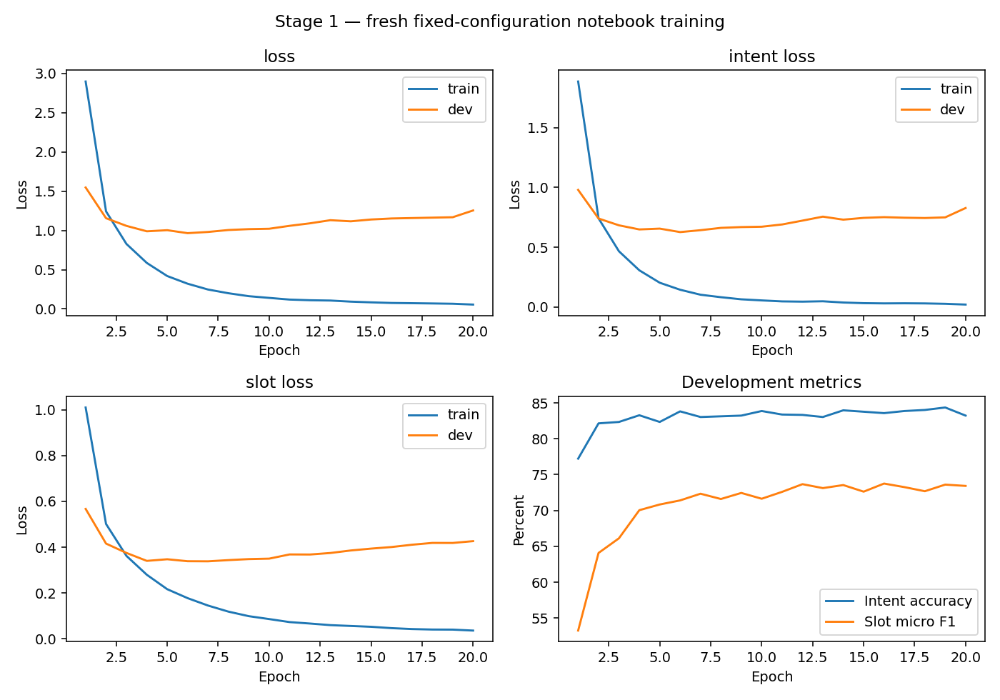
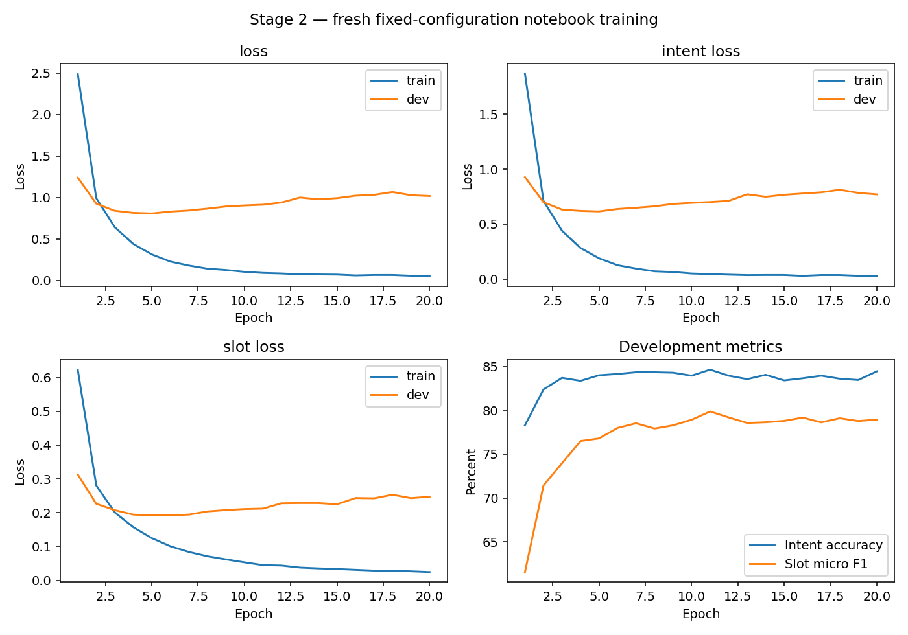

# Experiments and error analysis

**Historical evaluator-v1 evidence.** All scores, chosen epochs, ablations, paired counts, error strata and plots below came from the earlier type/text-set scorer. They are preserved as a dated research record. The current `exact_character_span_v2` scorer uses original character occurrences in both notebooks; current comparative scores and fresh error analysis are **pending rerun**. Do not rank the revised BiLSTM and Transformer from this table or relabel these numbers as v2. See the [comparison contract](EVALUATION_COMPARISON.md).

The previously executed BiLSTM notebook and its [preserved results](../results/historical_v1/) were the evaluator-v1 report sources. Its original executed bytes are retained locally under `artifacts/evaluator_v2/prechange/`; the active [BiLSTM](../main.ipynb) and [Transformer](../NLP_Final_project.ipynb) notebooks await fresh v2 execution. This document consolidates the useful content of the former experiment-plan, diagnosis and error-analysis files. The exact original registrations and raw documents remain in the ignored local archive and immutable snapshots; they are historical provenance, not additional public entry points.

## Registered research

Stage 1 registered three 20-epoch candidates before full training. Stage 2 diagnosed **development** errors and registered five 20-epoch candidates before its first full run. Both used original full splits, seed 42, fixed scoring and unrounded development-mean selection, with earlier candidates/epochs winning exact ties. All eight runs and 160 epochs completed. Test scores did not select settings.

| Stage / candidate | Parameters | Selected / trained epoch | Dev intent | Dev slot F1 | Script workflow seconds |
| --- | ---: | --- | ---: | ---: | ---: |
| Stage 1: lr 0.001, dropout 0.2 | 4,646,571 | 17 / 20 | 83.82% | 73.52% | 112.09 |
| Stage 1: lr 0.0005, dropout 0.2 | 4,646,571 | 17 / 20 | 83.47% | 73.53% | 113.83 |
| **Stage 1: lr 0.001, dropout 0.3** | **4,646,571** | **19 / 20** | **84.36%** | **73.61%** | **106.81** |
| Stage 2: character CNN | 4,916,011 | 15 / 20 | 84.65% | 74.70% | 161.91 |
| Stage 2: CRF | 4,659,114 | 14 / 20 | 84.31% | 77.85% | 350.81 |
| Stage 2: predicted-intent context | 4,657,515 | 12 / 20 | 84.36% | 74.14% | 155.05 |
| Stage 2: characters + CRF | 4,928,554 | 17 / 20 | 84.65% | 78.16% | 312.10 |
| **Stage 2: characters + CRF + context** | **4,939,498** | **11 / 20** | **84.65%** | **79.88%** | **323.98** |

The three baseline workflows totaled **332.73 seconds**; the five Stage 2 workflows totaled **1,303.85 seconds**. These are local observations, not controlled component microbenchmarks. Raw registration-document SHA-256 values remain:

```text
Stage 2 original plan MD: 99748db7f28fd3b3d51920fb44f85cf357c77c0fce3e23b0127b1836e247bb3b
Stage 1 original plan JSON: 62cc0e2b9eb79d8794f94be128c5db59420076b660c025397850d53ae128a345
Stage 2 original plan JSON: b6688143677c099ca0d7015cf04c45d3e4391b3232340748e2557866805a78db
```

The local archives retain the exact original bytes and filenames required by raw-hash research audits. Consolidating the current prose does not retroactively amend registration. A pre-training correction changed two provisional diagnostic category counts by one record; no hypothesis/configuration changed.

## Development diagnosis and qualified findings

Baseline development contained **351 OOV utterances**: intent accuracy/slot F1 were **70.94% / 58.39%**, versus **87.16% / 76.99%** without OOV words. Unseen `(type, text)` pair recall was **37.48%**, versus **89.72%** for seen pairs. Recall for slots of at least three tokens was **58.15%**. Among 480 missing gold pairs, **183** overlapped a same-type prediction with incorrect boundaries, **65** had exact boundaries but wrong types, **48** had mixed overlap and **184** had none.

These observations motivated spelling features, structured boundaries and predicted-intent interaction. They did not justify simply adding hidden capacity: development loss rose while training loss fell. Rare intents did not uniformly underperform, so blanket class weighting was not included. No pretrained vectors, Transformer replacement, additional task data or augmentation entered this bounded search.

- Character features alone produced little OOV slot gain (**58.39% → 58.63%**) and regressed OOV intent accuracy. The initial hypothesis received only partial support.
- CRF alone reduced false positives (**618 → 363**) but also true positives (**1,531 → 1,513**), trading some recall for precision.
- Intent context alone slightly improved overall slot F1 but reduced OOV slot F1 to **57.03%**. It helped more in combination: adding it to characters+CRF raised dev slot F1 by **1.72 points**, with unchanged aggregate intent accuracy.
- The selected system improved OOV slot F1 to **65.81%**, unseen `(type, text)` pair recall to **45.32%**, and long-slot recall to **66.13%**. Same-type boundary false negatives fell **183 → 108**; exact-boundary type errors stayed **65 → 65**. This does not establish the proposed type-error mechanism or statistical significance.

Selected dev TP/FP/FN are **1,576/359/435**, versus **1,531/618/480**. Paired intent outcomes include 64 corrections and 58 regressions; 130 gold slot pairs were recovered and 85 lost. Fully correct utterances increased from 1,262 to 1,359. Improvement is not uniform across examples.

Research motivation: [Ma and Hovy, 2016](https://aclanthology.org/P16-1101/) for character CNN/BiLSTM/CRF sequence labeling; [Goo et al., 2018](https://aclanthology.org/N18-2118/) for intent-slot interaction. The small soft-context implementation does not reproduce the full published slot-gate system or inherit its benchmark claims.

## Historical evaluator-v1 notebook reproduction

The notebook independently trained both selected configurations for 20 epochs each, selected epochs 19/11 again, and produced the same model-state values, ordered predictions and full-precision metrics as the scripts. It used its own newly trained checkpoints; file hashes differ because provenance/metadata are new.

| System | Dev intent | Dev slot F1 | Test intent | Test slot F1 | Notebook workflow seconds |
| --- | ---: | ---: | ---: | ---: | ---: |
| Stage 1 | 84.36% | 73.61% | 83.96% | 70.51% | 127.51 |
| Stage 2 | 84.65% | 79.88% | 82.62% | 76.81% | 359.09 |

**Test tradeoff:** slot F1 improves **6.30 percentage points**, intent accuracy decreases **1.34 points**, and their balanced mean increases **2.48 points**. Development gains are +0.30 / +6.27 points. Deltas use unrounded values. No final test result caused another tuning cycle.

Workflow timing includes train, epoch development scoring, checkpoint writes and logs, excluding setup/download, plotting, independent reload and final evaluation. Per-evaluation timer boundaries differ across stage algorithms. CRF NLL and token CE also differ, so neither evaluation seconds nor absolute loss heights establish isolated architectural superiority.

## Four actual historical Stage 2 development errors

These are drawn from the evaluator-v1 notebook's own saved predictions; they remain genuine historical errors, not current v2 acceptance evidence. It displays full original gold/predicted spans and offsets; no examples were invented or added to training. There are **674** development utterances with any remaining error.

| Record | Original utterance | Gold | Prediction | Possible explanation, explicitly an inference |
| --- | --- | --- | --- | --- |
| 42 | give me the status on my available memory | Intent `general_quirky`; no slots | Intent `calendar_query`; no slots | Unfamiliar wording and ambiguity about an assistant's memory may contribute. Spelling features alone cannot establish the request's domain. |
| 67 | i'd like to hear queen's barcelona | Intent `play_music`; artist `queen's`, song `barcelona` | Correct intent; artist span `queen's barcelona` | The decoder merges adjacent entity meanings. Legal BIO structure does not guarantee semantic boundaries. |
| 24 | make a room darker | Intent `iot_hue_lightdim`; place `room` | Intent `iot_hue_lightup`; place correct | The model confuses opposite lighting actions despite finding the location. This example alone does not establish a cause. |
| 30 | cleaning is good dust is so bad do now your magic clean my carpet | Intent `iot_cleaning`; place `carpet` | Intent `calendar_remove`; no slots | Long, loosely structured wording may obscure the action/location; both task predictions fail. |

Further work should examine training support and development error strata, calibration and boundary/type behavior in a separately designed study. This single-seed search does not establish statistical significance or a global optimum, and it does not authorize test-driven retraining. Any account of the historical v1 run must retain its intent regression. A new report must use fresh v2 results and at least two errors from the freshly evaluated final system.

## Learning curves

Both plots are genuine historical evaluator-v1 notebook outputs. The original executed notebook is preserved in the ignored prechange archive; the active notebooks have no retained v2 training outputs yet. Rising development loss alongside falling training loss remains a limitation; checkpoint selection follows the declared task metrics.




