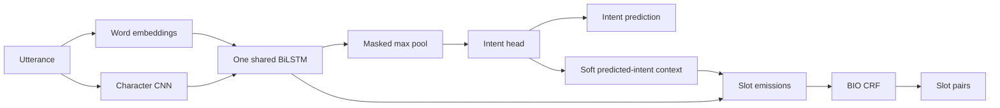

# Models, data and evaluation

The executable reference is [main.ipynb](../main.ipynb). It embeds the required definitions and selected settings, trains each model for 20 epochs, saves/reloads its own checkpoints and retains genuine outputs. The script modules remain useful for development; historical experiment/audit entry points additionally need the ignored local evidence archive and, for exact-hash audits, the original layout.

## Data and scoring

Use original MASSIVE 1.0 English: **11,514 train / 2,033 dev / 2,974 test**, 16,521 records total. Input features derive only from `utt`; intent and annotated slots are targets. No augmentation, external task data, filtering, resplitting or truncation is used.

Observed English-file SHA-256:

```text
c70f75c6a543a26e249ec383df67733ad9b1066f6c0406c2e04a3f03356e407e
```

This is a recorded reproducibility identity, not an independently published authenticity certificate. Acquisition streams the official archive and safely extracts exactly its English member. Annotation markup must reconstruct `utt` exactly. Offsets are zero-based, end-exclusive Python Unicode character offsets; every slot text equals its original utterance slice.

The fixed tokenizer is `\w+|[^\w\s]`: Unicode word runs and individual non-whitespace punctuation. It preserves case and offsets with no normalization. Dynamic right-padding preserves every token; packed LSTM lengths and masks exclude padding.

Training-only mappings contain **5,146 word IDs**, **60 intents**, **55 slot types** and **111 BIO tags**. Word PAD/UNK IDs are 0/1; BIO `O` is 0; padded slot labels use -100. Vocabulary ordering is descending training frequency followed by lexical ties. Stage 2 fits **34 character IDs** (PAD/UNK plus 32 observed training characters) from original train tokens only. Unknown development/test words or characters never extend either vocabulary.

One immutable prediction contains `record_id`, predicted intent and exact slot objects (`slot_type`, `text`, `start`, `end`). IDs/offsets are audit sidecars rather than predictive features. Intent accuracy uses exact labels. Slot scoring compares **sets of literal `(type, surface text)` pairs within each record**, then pools TP/FP/FN across the split. Duplicate identical pairs collapse within a record; offsets do not enter the scoring key. There is no normalization or partial credit. Empty-slot denominator gives F1=0; an empty dataset or missing/duplicate prediction IDs is an error.

This is the documented project interpretation of the assignment; lecturer-scorer parity is unverified. Baseline BIO decoding starts a new span at an orphan or type-changing `I` tag. Stage 2's constrained decoder emits legal BIO paths. Both reconstruct text using the same original-string slicing and shared scorer.

## Stage 1

Trainable **256-dimensional word embeddings** feed one packed **bidirectional LSTM, 512 hidden units per direction**. Explicit embedding/output dropout is **0.3**. Masked max-pooling over real-token encoder outputs feeds the 60-class intent head; token outputs feed a 111-class linear BIO head.

| Component | Parameters |
| --- | ---: |
| Word embeddings, 5,146 × 256 | 1,317,376 |
| Both BiLSTM directions | 3,153,920 |
| Intent head | 61,500 |
| Slot head | 113,775 |
| **Total / trainable** | **4,646,571 / 4,646,571** |

Intent loss is summed cross-entropy divided by utterance count. Slot loss is summed token cross-entropy divided by real-token count, ignoring padded labels. Their weights are 1.0 each. One optimizer updates the complete shared model.

The original smaller 128/128 diagnostic model was superseded before full experiments. Full Stage 1 experiments compared only the selected 256/512 architecture, so no empirical improvement from increasing model size is claimed.

## Stage 2

The selected system keeps the same word embeddings, encoder dimensions and intent head. It adds a **32-dimensional character embedding and width-3, 64-channel CNN**, with ReLU and masked maximum pooling, to each token's word features. The shared BiLSTM therefore receives 320-dimensional inputs.

The intent head's predicted probabilities weight a learned **64-dimensional intent-context embedding**, which is concatenated to each token output. Gold intent is never a forward feature, and the context remains differentiable. A linear slot head feeds a **BIO-constrained linear-chain CRF**. Illegal starts/transitions have exact negative-infinity scores in likelihood and Viterbi decoding; learned transition orientation is `[previous, next]`. Padding contributes neither character features nor CRF loss/decoding.



| Component | Parameters |
| --- | ---: |
| Word embeddings | 1,317,376 |
| Both shared BiLSTM directions | 3,416,064 |
| Intent head | 61,500 |
| Context-conditioned slot head | 120,879 |
| Character embeddings | 1,088 |
| Character convolution | 6,208 |
| Intent-context embeddings | 3,840 |
| CRF start/end/transitions | 12,543 |
| **Total / trainable** | **4,939,498 / 4,939,498** |

The slot objective is summed sequence CRF negative log likelihood divided by real-token count, plus the same per-utterance intent cross-entropy. Both task weights remain 1.0. CRF NLL and independent-token CE have different meanings; their absolute loss heights are not an architectural performance comparison.

Both stages are one joint model per stage. All embeddings, both heads and every registered learned parameter—including masked CRF parameters and padding embedding rows—are counted. Nonlearned Boolean buffers are not parameters. Neither model uses pretrained weights or vectors; both complete systems are below 20M.

## Training and selection

| Setting | Both selected systems |
| --- | --- |
| Optimizer | AdamW |
| Learning rate / weight decay | 0.001 / 0.0001 |
| Batch size / full budget | 32 / 20 epochs |
| Gradient norm clipping | 5 |
| Explicit dropout | 0.3 |
| Seed / precision | 42 / FP32 |
| Selection | Highest unrounded mean of dev intent accuracy and slot F1 |
| Ties | Earlier epoch; earlier registered candidate across research runs |
| Loader | Train shuffle; persistent seeded generator; workers=0; drop_last=False |
| Scheduling / early stopping | None |

All RNGs are reset before each model construction; Stage 2 is freshly initialized. `PYTHONHASHSEED=42` must be set at process startup; `CUBLAS_WORKSPACE_CONFIG=:4096:8` precedes CUDA work. Strict deterministic algorithms, deterministic cuDNN, disabled benchmark and TF32 apply. This does not guarantee identical results on different hardware/software.

Each epoch covers **11,514 unique training records / 83,008 tokens** and **2,033 development records / 14,522 tokens**. Final test covers **2,974 records / 21,089 tokens**. Batch counts are 360/64/93. Epoch losses aggregate component sums over their actual global denominators.

The checkpoint stores independent model/optimizer snapshots, settings, mappings, source/data identities, selected epoch and exact development predictions. A distinct Python process generated from notebook-visible definitions independently refits train mappings, reloads the new checkpoint and checks every ordered development prediction and unrounded score. The parent reloads again, freezes before test, evaluates test once and confirms unchanged weights/checkpoint bytes. Repeated final evaluation and output overwriting are guarded.

The standalone notebook's selected epochs are **19 and 11**. Its generated four-row results and actual timings are in [results](../results/). The historical research trained three baseline and five Stage 2 candidates; the notebook reproduces the two fixed selected configurations for 40 epochs rather than claiming another 160-epoch search.

The initial `configs/stage1.json` and baseline class default retain historical dropout 0.2. Use `configs/phase4/stage1_dropout03.json` and `configs/phase5/char_crf_intent_context.json` for the selected settings; the notebook embeds them explicitly. Common-protocol historical pending architecture/training fields are superseded by those settings.

Historical Stage 1 script training closure is procedural; Stage 2 enforces its freeze guard. The notebook's own exclusive output/freeze checks cover both stages. Earlier Stage 1 histories lack persisted per-epoch ID hashes, although its frozen loop validates ID membership; Stage 2 and the notebook retain hashes. Historical summaries also contain some local absolute paths; the notebook uses execution-relative checkpoint paths.

Exact interrupted-run resumption is not implemented: checkpoints do not preserve every RNG and loader state. Reproduction starts a fresh complete run rather than claiming an interrupted run will continue bit-for-bit.
