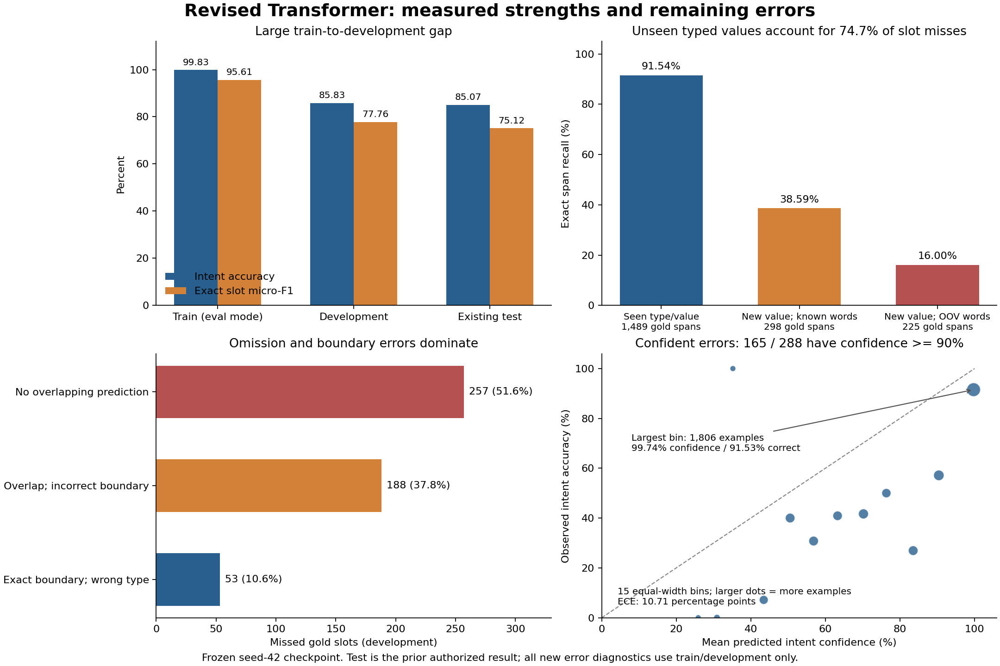

# Revised Transformer: performance assessment and ranked improvement proposals

**Subsequent implementation:** recommendations 1 and 2 have now been implemented
and evaluated in a separate notebook. See the
[regularization results](TRANSFORMER_REGULARIZATION_RESULTS.md) and
[run guide](TRANSFORMER_REGULARIZATION.md). The assessment below is preserved as
the diagnosis made before those experiments; its statements about unimplemented
proposals refer to that earlier point in the work.

Assessed **11 November 2026**, against the current revised notebook, selected checkpoint, verified dataset, saved comparison evidence, and new read-only train/development diagnostics.

**Conclusion:** the revised model is a substantially better measured system than the original Transformers, particularly for slots. Its remaining weakness is generalization to unfamiliar utterances and slot values. It already fits the training set extremely well and uses **19,748,595 parameters**. The strongest next experiment is to train the unknown-word condition through mild rare-word dropout while retaining character inputs. Mild intent label smoothing is the next inexpensive experiment. More capacity is poorly motivated by the current evidence.

**No proposed improvement has been implemented or trained.** This assessment made no model, notebook, training-source, configuration, or checkpoint changes; performed zero optimizer updates; and made no new test forward passes. Existing test scores below come from the previously authorized frozen comparison. New diagnostic inference used train/development only. All protected input hashes and the loaded model-state hash remained unchanged.

The recommendations are ranked by evidence supporting their mechanism and their practical experiment priority. These are **not measured probabilities of success or promised score gains**. In particular, the ordering among positions 3–5 is uncertain, and no candidate has yet demonstrated an improvement in both metrics.

## 1. Evidence and evaluation contract

- Model: [NLP_Final_project_revised.ipynb](../NLP_Final_project_revised.ipynb), improved Stage 2 system.
- Selected checkpoint: `artifacts/revised_transformer/normalized_qualification/transformer_run_artifacts/stage2/best.pt`; selected at epoch **19** of a completed 20-epoch seed-42 run.
- Checkpoint SHA-256: `2bbcebad84b3df6671afa84997259f158903360743ea8b1795cec808381843aa`.
- Dataset: original MASSIVE 1.0 English, **11,514 train / 2,033 development / 2,974 test**. Dataset SHA-256: `c70f75c6a543a26e249ec383df67733ad9b1066f6c0406c2e04a3f03356e407e`.
- Evaluator: `exact_character_span_v2`. Intent accuracy is correct utterance intents divided by utterances. Slot micro-F1 pools exact typed-span TP/FP/FN over utterances: `2TP / (2TP + FP + FN)`. Boundary mismatches are errors, including where the general entity meaning is plausible.
- New train/development measurements used the same frozen weights in evaluation mode, with dropout disabled. This makes the train/development comparison meaningful; it is not a comparison of stochastic training loss against deterministic evaluation loss.
- Fresh development inference reproduced the saved ordered predictions. Confidence analysis used these logits. A separate gradient probe computed gradients only; it never called an optimizer step.
- Test scores and paired bootstrap intervals were read from the existing frozen comparison. Test errors were not used to design these proposals.

Portable numerical evidence, including per-intent and per-slot breakdowns, is in [assessment.json](../results/revised_transformer_assessment/assessment.json). The previous architecture/assignment audit and frozen comparison are in [TRANSFORMER_COMPARISON_REVIEW.md](TRANSFORMER_COMPARISON_REVIEW.md). Full local diagnostic scripts and detailed intermediate results are retained under `artifacts/revised_transformer_assessment/`.



## 2. What the current architecture does well

The system jointly learns both tasks through one shared encoder:

```text
Raw utterance
  -> train-fitted 300d word embeddings + masked 192d character-CNN features
  -> separate branch normalization -> 512d projection + positions
  -> six shared pre-LN Transformer blocks (8 heads, FFN width 1792)
       |-> attention + max pooling -> MLP -> 60 intent probabilities
       |                                      |
       |                          soft 64d predicted-intent context
       |                                      |
       +-> token features + intent context -> MLP -> 111 BIO emissions
                                                        -> constrained CRF
```

All word embeddings, character parameters, shared layers, heads, intent embeddings, and CRF weights count toward the cap. Total and trainable counts are both **19,748,595**, leaving **251,405** below 20M. The word table accounts for 1,590,000 parameters and the shared encoder for 17,340,928. No pretrained contextual encoder is used. Gold intents and annotated slot strings are targets, not prediction inputs.

The current recipe uses batch size 32, AdamW with base learning rate `5e-4` and word-embedding learning rate `1e-4`, weight decay .01, gradient clipping at 1, 10% warmup, cosine decay with a 10% learning-rate floor, and dropout .25. The intent objective is mean cross-entropy; the slot objective is summed sequence CRF negative log-likelihood divided by real-token count. Both coefficients are 1. Checkpoint selection maximizes the unrounded mean of development intent accuracy and slot F1.

| System | Parameters | Dev intent | Dev slot F1 | Test intent | Test slot F1 |
| --- | ---: | ---: | ---: | ---: | ---: |
| Original word-only Transformer | 4,345,243 | 84.16% | 69.56% | 82.92% | 66.77% |
| Original character Transformer | 4,379,947 | 85.34% | 70.98% | 83.86% | 69.11% |
| **Revised Transformer** | **19,748,595** | **85.83%** | **77.76%** | **85.07%** | **75.12%** |

Against the original character model, the revised system gains **1.21 percentage points intent accuracy and 6.02 points slot F1 on test**. Existing paired 20,000-resample utterance bootstrap intervals are `[0.24, 2.19]` and `[4.67, 7.35]` points respectively. These support a real difference between these frozen predictions; they do not establish robustness across training seeds or isolate which architectural change caused the gain. There is no multiple-comparison correction.

The revised run took **603.64 seconds** for 20 epochs of training plus per-epoch development evaluation, versus **244.57 seconds** for the original character model: approximately 2.47 times as long with 4.51 times as many parameters. Its recorded peak allocated CUDA tensor memory was approximately **637.71 MiB**; this excludes reserved memory, CUDA context, other applications, and host memory. These are measurements of this local run, not guarantees for every configuration.

The CRF is doing substantial decoding work: compared with the raw emission argmax, it changes 3,720 development token decisions, including 3,018 changes to the correct tag and 150 away from it. This is descriptive evidence within the jointly trained CRF model, **not a fair no-CRF ablation**. There is no current evidence for removing it.

## 3. Performance and failure diagnosis

### Generalization is the main bottleneck

| Frozen revised checkpoint | Intent accuracy | Slot precision | Slot recall | Slot micro-F1 |
| --- | ---: | ---: | ---: | ---: |
| Train, evaluation mode | 99.83% | 95.62% | 95.61% | 95.61% |
| Development | 85.83% | 80.45% | 75.25% | 77.76% |
| Existing frozen test reference | 85.07% | 78.36% | 72.15% | 75.12% |

Training has only **20 wrong intents among 11,514 utterances**. Development has **288 wrong intents**, **368 false-positive slots**, and **498 missed gold slots**. Only **1,318/2,033 = 64.83%** of development utterances have both the correct intent and the complete correct slot set.

The **13.99-point intent and 17.85-point slot-F1 train/development gaps** favor regularization and better handling of unfamiliar inputs over indiscriminate capacity increases. This diagnosis does not prove that every smaller model would perform better; there is no controlled capacity ablation yet.

### Unfamiliar slot values explain most missed slots

For this diagnostic only, a value is considered seen if its `(slot type, case-folded text)` occurs in train. Known/OOV words use the existing train-only vocabulary. This grouping does **not** relax the official exact-span evaluator.

| Gold development slot group | Gold slots | Correct | Exact recall |
| --- | ---: | ---: | ---: |
| Type/value seen in train | 1,489 | 1,363 | **91.54%** |
| Unseen type/value, all words known | 298 | 115 | **38.59%** |
| Unseen type/value, includes OOV words | 225 | 36 | **16.00%** |

Unseen typed values comprise **26.0% of gold slots but 74.7% of missed slots**: 372 of 498 misses. This is consistent with substantial lexical memorization and weak transfer to new values. The groups also differ in type and difficulty, so the association alone is not a causal ablation.

OOV handling is a specific, verified training mismatch:

- The word vocabulary includes every training token type. Therefore **UNK appears zero times as a training input**.
- Development contains **464 UNK occurrences among 14,172 tokens, or 3.27%**.
- The selected optimizer's first- and second-moment rows for UNK are exactly zero. Simulating its 6,840 float32 AdamW decay steps reproduces its final row exactly. Its observed movement is consistent with weight decay alone, with no task-supervised update.
- Character inputs still preserve the spelling, but the combined network never learns from a training example whose word identity is missing in this way.

Fixing this cannot solve every novel-value error: **183 misses involve new values made entirely from known words**. The broader issue includes contextual composition and deciding which words form a value.

Blindly predicting more entities is risky. Predictions containing a typed value seen in train have **87.60% precision**; predictions containing an unseen value have only **46.32% precision**. A recall gain that creates many additional unsupported spans can lower exact F1.

### Omission and boundaries matter more than type-only errors

The 498 development false negatives break down as follows. Each gold slot belongs to one category; these are descriptive categories, not independent repairable gains.

| Missed-gold category | Count | Share |
| --- | ---: | ---: |
| No overlapping predicted span | 257 | 51.61% |
| Overlapping prediction, incorrect boundary | 188 | 37.75% |
| Exact boundary, incorrect slot type | 53 | 10.64% |

Ignoring slot type solely for diagnosis gives **80.48% whole-boundary F1**, compared with 77.76% exact typed F1. Start-position recall is 82.01%; end-position recall is 83.25%. These diagnostics support investigating detection/boundaries, but they are not alternative performance scores for the assignment. Start/end objectives could still be redundant with the existing BIO/CRF objective.

Recall is 83.32% for one-token spans, 64.96% for two-token spans, 47.22% for three-to-four-token spans, and 67.29% for spans of five or more tokens. The non-monotonic pattern reflects differing entity mixes; length alone is not established as the cause. Adjacent-entity merging affects only **7 of 172 adjacent gold pairs**, so it is not the dominant error mechanism.

The largest slot error counts, measured as FP+FN, are `place_name` **98**, `person` **80**, and `event_name` **75**. Together they account for 29.2% of all slot error occurrences, despite substantial training support of 1,086, 864 and 998 spans. This does not support rare-label weighting as the first remedy.

### Intent errors include semantic confusion and overconfidence

| Intent | Train examples | Dev examples | Wrong | Recall |
| --- | ---: | ---: | ---: | ---: |
| `general_quirky` | 555 | 105 | 58 | 44.76% |
| `qa_factoid` | 544 | 90 | 22 | 75.56% |
| `calendar_query` | 566 | 102 | 18 | 82.35% |
| `calendar_set` | 810 | 131 | 14 | 89.31% |

`general_quirky` alone contributes **20.1% of intent errors**. Its confusions include factoid questions and news requests. These classes are not simply absent or extremely rare in training. Macro intent recall over the **59 intents represented in development** is **86.91%**, higher than overall accuracy, so there is no blanket diagnosis that rare intents dominate the micro-level problem.

The mean predicted intent confidence is **96.48%**, while accuracy is 85.83%. Of 288 mistakes, **165 are at least 90% confident and 111 at least 99% confident**. Expected calibration error is **10.71 percentage points**, using 15 equal-width bins. Lower-confidence bins have small support; ECE depends on binning.

The correct intent is among the top two predictions on 91.34% of examples and the top three on 93.31%. These are oracle diagnostics, not attainable accuracy gains without learning a better decision rule. Temperature scaling alone preserves intent argmax and therefore cannot increase intent accuracy.

### More task coupling is not the clearest solution

**409/498 = 82.1% of missed slots occur when intent is already correct.** Conversely, **137/288 = 47.6% of intent errors occur on utterances with no gold slots**. More intent-to-slot or slot-to-intent feedback may help selected cases, but neither direction supplies the missing answer for most errors automatically. The existing model already conditions slots on soft predicted intent.

A hard train-derived intent/slot compatibility mask would exclude some valid combinations: development contains 16 gold slot occurrences from 14 type/intent pairs unseen in train. Among existing predictions, such a mask would encounter 17 false-positive spans but also 12 true-positive spans. This is a compatibility count, not an executed filtering experiment, and argues against treating absent train combinations as impossible.

### Training diagnostics rule out some simplistic fixes

- **Earlier stopping by minimum development loss is worse here.** Minimum joint development loss occurs at epoch 5, with **83.28% intent / 70.10% slot F1**, versus epoch 19's 85.83% / 77.76%. Loss rises while task decisions continue improving. Keep task-metric selection; do not substitute loss-only stopping because the loss curve looks cleaner.
- **Late training is relatively stable but not identical.** Epochs 15–20 range from 85.10–85.83% intent and 77.21–77.91% slot F1. Epoch 18 has slightly higher slot F1 than 19, but lower intent accuracy. This suggests testing averaging, not assuming that the last epoch or slot-only optimum improves both tasks.
- **Slots are not demonstrably underweighted.** A probe of 512 training examples in 16 batches at the selected checkpoint found a median shared slot/intent gradient-norm ratio of **14.03**, with median cosine **−0.007**. This is a late, dropout-disabled snapshot when intent is nearly fitted; it does not establish gradient balance or conflict throughout training. It does rule out confidently prescribing a larger slot coefficient without a controlled trial.
- **No strong evidence of catastrophic embedding forgetting.** Ordinary word embeddings have median initial/final direction cosine **0.9909**, and none below .9. Their median relative update norm is 13.50%, so they did adapt. Permanent freezing or dramatically reducing their already lower learning rate is not the best-supported first change.
- **A few annotation ambiguities do not explain the gap.** There are 46 duplicated raw training utterances, including five conflicting target groups. These imply at least four unavoidable intent errors for an identical-input deterministic classifier, not thousands of generalization errors. Preserve official examples and labels; do not remove or rewrite difficult records.

## 4. Ranked improvement proposals

### 1. Rare-word dropout that teaches the model to use UNK and characters

**Evidence strength: strongest direct mechanism. Main target: slot generalization; possible intent benefit.**

During training only, replace some word lookup IDs with UNK while keeping the real characters, original positions, utterances, and targets. A conservative first proposal is

`p_UNK(word) = 0.25 / (training_frequency(word) + 0.25)`.

For this actual training corpus, that masks an expected **1.43% of tokens** per epoch. Alpha .5 would mask 2.56%. An alternative is replacing training singletons with probability .5, which masks 1.56% of all training tokens. These are alternatives, not changes to stack together. Frequencies must come from train only. No target OOV-rate matching is required.

The frequency formula is used by [Kiperwasser and Goldberg, section 6](https://aclanthology.org/Q16-1023.pdf); [Lample et al., section 4](https://aclanthology.org/N16-1030.pdf) explicitly train UNK using singleton replacement. Their tasks differ, so their results establish precedent, not a guaranteed MASSIVE improvement.

**Why it could work:** it directly fixes the missing training condition, trains the UNK representation, and discourages dependence on memorized word identities. Keeping characters encourages the existing fallback pathway rather than adding parameters.

**Why it might fail:** rare intent keywords can be essential; too much masking harms seen-value performance. Characters do not supply external knowledge about arbitrary artists or places. New values composed of known words may remain difficult.

**Cost and validation:** zero added parameters, unchanged inference, minimal training overhead. Compare baseline against alpha .25 first. Require improvement in overall task scores, and examine new-value/OOV recall, seen-value recall, precision, and no-slot false positives. A gain confined to OOV recall with lower total F1 is not success. This is feature dropout over existing examples, not synthetic-data augmentation.

### 2. Mild label smoothing on the intent objective

**Evidence strength: well-motivated intent experiment, uncertain slot effect.**

Test intent cross-entropy smoothing **epsilon .05**, with .10 only as a limited follow-up. Keep the CRF objective and architecture unchanged. [Müller et al.](https://arxiv.org/abs/1906.02629) study generalization/calibration benefits and loss of useful inter-class logit information; both considerations matter here.

**Why it could work:** the intent classifier nearly memorizes train and makes many extremely confident development errors. Mildly softer supervision may reduce excessive margins and improve unseen utterance decisions.

**Why it might fail:** confidence can improve without accuracy improving. Smoothing can weaken useful distinctions between similar intents. Since slots consume the full intent distribution, changed confidence may help or damage slot predictions even if intent argmax is unchanged.

**Cost and validation:** zero extra parameters and negligible runtime. Compare accuracy, exact slot F1, joint correctness, NLL/ECE, and confidently wrong predictions. Choose by the required task metrics, not calibration alone. Do not apply ordinary CE label smoothing to the structured CRF loss without defining a different structured objective.

### 3. R-Drop consistency regularization, initially on intent

**Evidence strength: moderate; strong generalization rationale but no local experiment.**

Use two dropout-enabled forward passes of each original training example through the **same model weights**, average their supervised intent/CRF losses, and penalize disagreement between intent distributions with symmetric KL. [R-Drop](https://arxiv.org/abs/2106.14448) provides primary evidence for this regularization mechanism across several tasks, not this specific joint CRF system.

**Why it could work:** it discourages predictions that depend too strongly on a particular dropout realization. The current train/development gap and overconfident errors make this a plausible route to more stable intent and shared representations.

**Why it might fail:** two views can agree on the wrong intent; an excessive consistency weight suppresses useful learning. There is no direct guarantee of better slot boundaries. KL between raw slot-emission softmaxes is not KL between the CRF's structured distributions, so naively applying token KL should not be described as full CRF consistency.

**Cost and validation:** no extra prediction-time model parameters, but two stochastic views substantially increase training compute and activation memory. Benchmark on the 8 GB GPU. Test separately from smoothing, keep supervised loss scaling explicit, and compare both task metrics with matched seeds. A small predeclared KL-weight trial is appropriate; extensive weight searching is not justified yet.

### 4. Average nearby checkpoints from a single training run

**Evidence strength: moderate, with uncertain ordering relative to R-Drop and embedding replacement.**

Retain several predeclared late checkpoints from one run and average their weights into **one final predictor**. For example, test a fixed last-three-checkpoint window, rather than searching many subsets. The [original Transformer, section 6.1](https://arxiv.org/html/1706.03762v7) used checkpoint averaging. [SWA](https://arxiv.org/abs/1803.05407) provides related evidence, but uses a different optimization/scheduling regime; arbitrary averaging here is not a reproduction of canonical SWA.

**Why it could work:** nearby late epochs have slightly different task tradeoffs. Averaging can reduce sensitivity to a particular weight iterate without increasing inference size.

**Why it might fail:** similar scalar scores do not prove complementary errors or favorable weight-space geometry. Averaging can blur a good optimum. Do not average independently initialized seeds or different architectures. EMA is a separate timing/weighting policy, not an interchangeable label for this experiment.

**Cost and validation:** final predictor remains **19,748,595 parameters** with unchanged inference. Additional snapshots and an averaging pass are needed. The current run did not retain every historical checkpoint, so this cannot be evaluated retrospectively from the saved best file alone. A future matched run should compare its best checkpoint against its predefined average on dev. Do not retain multiple full predictors as an ensemble.

### 5. Replace the static 300d word-vector initialization

**Evidence strength: moderate to low until coverage and domain suitability are measured.**

Try one permitted static source, such as a 300d fastText release, extracted for **exactly the existing training vocabulary**. Replace the table rather than concatenate another one. Current initialization covers **4,731/5,298 ordinary training word types, or 89.30%**; 567 start without a source vector. [Official fastText resources](https://fasttext.cc/docs/en/english-vectors.html) describe available English vector sources; [Bojanowski et al.](https://aclanthology.org/Q17-1010/) describe the subword mechanism.

**Why it could work:** a different corpus and vector construction may improve rare-word semantics and the initial representation of currently uncovered training vocabulary.

**Why it might fail:** coverage is not semantic quality, and a mismatched source can perform worse. Extracting a static task table does not generate vectors for new development words: those still map to UNK. A `.vec` table is not the full subword model needed for arbitrary runtime OOV composition.

**Cost and validation:** same 5,300-by-300 table, so unchanged **19,748,595 total parameters**. Preparation/download cost can be substantial. Audit train coverage and source identity first, then perform one matched run. Do not add development/test vocabulary or retain an uncounted external runtime model. A two-million-by-300 full table alone has **600M parameters**, outside the cap.

### 6. Investigate task-loss weighting in both directions

**Evidence strength: conditional; the beneficial direction is unknown.**

If the targeted regularizers do not resolve the tradeoff, compare slot coefficients **.5, 1, and 2**, keeping intent weight and all loss reductions fixed. Record representative task gradient magnitudes and angles early, mid-run and late. The current terminal gradient probe is insufficient for automatically prescribing a particular coefficient or gradient-surgery algorithm.

**Why it could work:** mean intent CE and token-normalized CRF NLL have different scales and training dynamics. A fixed equal coefficient does not guarantee the best joint optimum.

**Why it might fail:** improving one task may degrade the other. The late slot gradient is already larger, so raising it may further prioritize slots without improving total generalization. Dynamic methods add complexity before the problem they solve has been established; [GradNorm](https://arxiv.org/abs/1711.02257) and [PCGrad](https://arxiv.org/abs/2001.06782) address specific balancing/conflict mechanisms, not every joint-learning failure.

**Cost and validation:** static coefficients add no parameters and negligible compute. Report both metrics separately; a higher arithmetic mean is not evidence that both tasks improved. Dynamic alternatives need separate justification and extra gradient bookkeeping.

### 7. Auxiliary start/end boundary supervision

**Evidence strength: exploratory local hypothesis. Main target: slots.**

One small proposal is two Bernoulli logits per token from the existing 512d shared representation: whether the token starts a gold slot and whether it ends one. Train the auxiliary loss from original training annotations; keep the existing CRF as the predictor. A single `512 -> 2` linear layer adds **1,026 parameters**, bringing the total to **19,749,621**, including the auxiliary head even if it is not used at inference.

**Why it could work:** most missing slots lack a correct boundary, and only 53 of 498 misses are type-only mistakes. Explicit boundary supervision may encourage transferable boundary features.

**Why it might fail:** BIO/CRF already supplies boundary information. Additional labels may be redundant, overemphasize numerous negative positions, or compete with slot typing and intent. Because the head does not alter decoding, any benefit must arise through better shared representations. This is an untested proposal derived from local errors, not a literature-backed expected gain for this architecture.

**Cost and validation:** minimal added compute; full total remains below 20M. Start with a small auxiliary-loss coefficient, keep masking/reduction explicit, and compare exact typed F1 as well as boundary diagnostics. Reject it if only the auxiliary metric improves or false-positive entities increase enough to offset recall.

### 8. Add a small local BiLSTM only by reallocating Transformer capacity

**Evidence strength: exploratory architecture experiment.**

A residual BiLSTM over 512d token states, hidden size 64 per direction, followed by a 128-to-512 projection could encourage local sequence structure. Both task heads should still use one shared system. Recurrent sequence-tagging evidence such as [Ma and Hovy](https://aclanthology.org/P16-1101/) motivates local order modeling, but does not establish a benefit when added to this already contextual Transformer.

Parameter arithmetic:

- BiLSTM: **295,936** parameters.
- Residual projection: **66,048**.
- Adding both without changes elsewhere: **20,110,579**, exceeding the cap.
- Reducing all six FFN widths from 1,792 to 1,664 saves **787,200**.
- Combined proposed system: **19,323,379**, before any additional norms or gates.

**Why it could work:** local order and boundaries might benefit from a recurrent inductive bias, while the smaller FFNs may reduce overfitting.

**Why it might fail:** recurrence adds sequential computation, can overfit, and does not automatically fix unfamiliar-value semantics. Reducing FFN capacity may harm intent. Any improvement could come from the smaller FFNs rather than recurrence.

**Cost and validation:** compare baseline, reduced-FFN-only, and reduced-FFN-plus-BiLSTM. Audit the instantiated total before training; these are arithmetic estimates, not an implemented model. Measure time as well as both metrics. This is a later experiment after lower-cost training fixes.

## 5. Changes with weak support or unacceptable tradeoffs

| Idea | Assessment |
| --- | --- |
| Add another unchanged Transformer block | Would total **22,638,579**, exceeding the cap; near-perfect train intent also makes more capacity a weak first response. |
| Train longer without changing regularization | Late metrics are fairly stable and train fit is already excellent. Possible small gains remain untested, but this does not directly address the observed mismatch. |
| Replace CharCNN with a character BiLSTM | A 96-hidden-per-direction replacement fits at **19,823,667**, but no evidence shows the current character encoder is the main bottleneck. New values with known words also fail. |
| Switch BIO to BIOES | Fits at **19,813,605**, but approximately quadruples tag-pair transition work (111 to 221 tags). Lample et al. report no significant IOBES advantage in their setting; benefit here is unproven. |
| Freeze embeddings to prevent forgetting | Current drift does not show severe forgetting, and the embedding learning rate is already five times smaller than the base rate. |
| Hard intent/slot compatibility masks | Would forbid some valid development combinations and risk removing true-positive spans. |
| Stronger task coupling as the first intervention | Most slot misses already have correct intent; the model already has soft intent context. Confidently wrong intents can propagate errors. |
| Aggressive rare-label weighting or oversampling | Frequent labels account for major errors; macro intent recall exceeds micro accuracy. This may help selected rare labels while lowering the requested overall metrics. |
| Increase all non-O scores | Creates a precision/recall and span-length tradeoff; unfamiliar-value precision is already low. It does not improve intent accuracy. |
| Pure intent temperature scaling | Changes confidence but not argmax accuracy. If used before slot context, it changes slot predictions and needs a separate controlled evaluation. |
| Select epoch 5 by minimum dev loss | Already measured to be worse on both requested metrics. |
| Ensemble two full revised models | **39,497,190** parameters, exceeding the entire-system cap. One averaged weight set is a different proposal. |
| Pretrained BERT/other encoder or generated task examples | Outside the project's stated permissions. Pretrained static word-vector initialization is the permitted exception. |
| Relax boundary scoring or remove difficult records | Would invalidate the required dataset/evaluator comparison, rather than improve the model under the assignment. |

## 6. Recommended experiment plan, if implementation is later authorized

Begin with a small **2-by-2 experiment**: unchanged baseline; rare-word dropout at alpha .25; intent label smoothing .05; both together. This isolates each effect and their interaction. Do not simultaneously change embeddings, loss weights, architecture, and schedule.

1. Use the pinned dataset, all original records, train-only mappings, exact evaluator, same initialization source, batch order/seed policy, 20-epoch budget, and current checkpoint-selection rule. Record the actual run configuration and full parameter count.
2. Screen the three new configurations with seed 42. Reuse the existing seed-42 baseline only after verifying that the extended implementation with new features disabled preserves initial weights, loss reductions, random-number/batch policy, optimizer, and schedule. The retained artifacts verify the old run; they do not automatically prove equivalence of future training code. Otherwise run a fresh unchanged seed-42 control.
3. If the screen is promising, run all four configurations with two additional predeclared seeds, for example 17 and 101. This is **11 new 20-epoch runs** if the existing baseline can be reused, or **12** with a fresh control, excluding any later proposals. At the existing run duration, training plus epoch evaluation alone is roughly 111–121 minutes; overhead and changed training work can alter this estimate.
4. Report each run and the mean/standard deviation of both required metrics. Do not pick the luckiest seed. An improvement in mean score with a decline in intent or slot F1 is a tradeoff, not an improvement in both.
5. Check the proposed mechanism: unseen-value/OOV recall, seen-value precision/recall, no-slot false positives, difficult intent classes, confidently wrong intents, and joint exact correctness. Lower ECE alone is insufficient.
6. Use paired utterance-level comparisons on development predictions, while distinguishing example-sampling uncertainty from training-seed variation. Three seeds are still a limited estimate, not proof of universal robustness.
7. Only then consider R-Drop or one-run checkpoint averaging. Keep their effects separately identifiable. Move to architectural changes only if the cheaper hypotheses fail or their residual errors justify another mechanism.

**Test boundary:** the official test set has already been evaluated in the earlier authorized frozen comparison. This assessment did not run it again. Future candidates should be selected using development only, and any eventual report of their results on the same test must disclose that prior exposure; it cannot be described as a newly untouched test. Avoid an extensive development sweep that effectively overfits the 2,033 development examples.

## 7. Limits of this assessment

The strongest conclusions are measured: the current frozen scores, the large train/development gap, the absent UNK training condition, the concentration of unseen-value slot misses, and confident intent errors. The causes inferred from subgroups are plausible explanations, not controlled causal findings. The research establishes relevant methods, not guaranteed gains on this dataset.

No candidate has been trained, no expected numerical gain has been invented, and no model has been changed. The precise likelihood that a proposal improves both metrics is unknowable from these diagnostics alone. The recommended experiment order is intended to resolve that uncertainty with a small, auditable set of comparisons.
