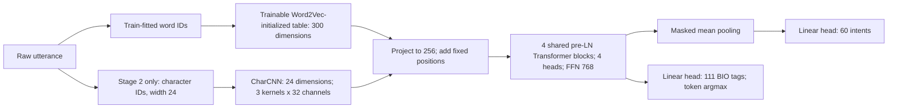
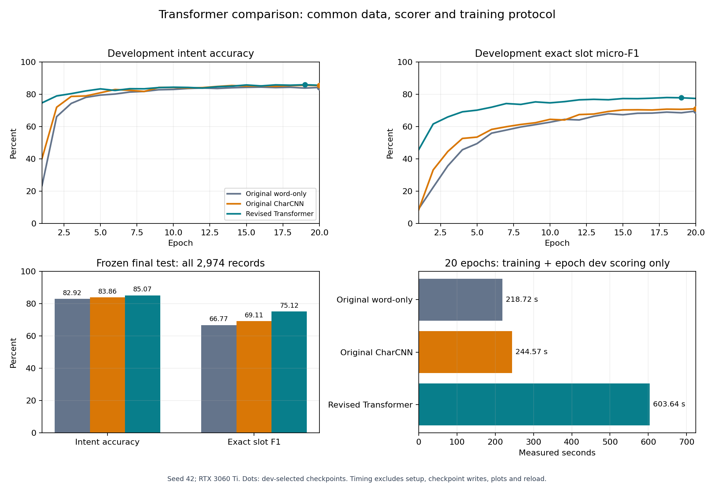

# Transformer notebook comparison and assignment audit

Reviewed **11 November 2026 (Singapore time)** against all five pages of [SC4002 Project Instructions.pdf](SC4002%20Project%20Instructions.pdf).

This review covers [the original notebook](../NLP_Final_project.ipynb) and [the revised notebook](../NLP_Final_project_revised.ipynb). It distinguishes notebook contents, measured model performance, and submission readiness. Both notebooks and the existing BiLSTM evidence are preserved.

## Recommendation

Use the **revised Transformer as the improved-system candidate**. It addresses several structural weaknesses, has completed and independently verified development runs, and improves the two required development metrics under a common training protocol. The original is useful provenance and a smaller, faster reference. It is incomplete as an executable two-stage submission.

Neither notebook, in its current saved form, is a finished submission. In particular, the revised notebook's retained execution is development-only. The separately authorized frozen-checkpoint test comparison described below supplies additional evidence; it does not insert test outputs into either notebook or certify the final three-file package.

**Deadline correction:** this newly supplied brief says **Friday, 13 November 2026, 11:59 pm SGT**, rather than Sunday, 15 November in `docs/assignment.pdf` and the older `docs/ASSIGNMENT.md`. Use the new PDF's date. Its substantive changes also explicitly require one joint framework and make the entire-system parameter cap, including word vectors, explicit.

## 1. Requirements that determine the comparison

- Predict one of **60 intents** and exact slot type/span pairs from **55 slot types**, using one joint system at each stage. Two task heads sharing a jointly trained encoder satisfy this implementation interpretation; separate task models do not.
- Use original MASSIVE **1.0 en-US**, preserving **11,514 train / 2,033 dev / 2,974 test** records. Fit model parameters and vocabularies on train, select settings/checkpoints on dev, and evaluate frozen checkpoints on test. No resplitting, removed records, external task examples or AI-generated training examples.
- The model's predictive input is **`utt`**. `intent` and `annot_utt` are labels, not predictive features.
- Each complete stage system must be within **20,000,000 total parameters**, including embeddings, frozen parameters and all heads. The two stage counts are checked separately. No pretrained encoder/model is permitted; pretrained word vectors are permitted.
- Use identical scoring for every experiment: intent accuracy and pooled exact type/span micro-F1, displayed as percentages to **two decimal places**. The mean of the two unrounded development fractions is a permitted project choice for selection; it is not a prescribed grading formula.
- Retain genuine epoch-level training/development losses and development results, elapsed time, learning curves, selected checkpoint epoch/score/filename, and a checkpoint reload reproducing the selected development score. Evaluate both stages on the final test set without further training.
- Submit exactly `main.ipynb`, `ai_collaboration.md` or `.txt`, and `report.pdf` inside `Group_<ID>.zip`. The notebook must include all required source and real outputs. The report has at most **two content pages excluding the cover**, with a four-row stage-by-split result table and at least two genuine improved-system error cases.
- The cover needs the group ID, all members' full names and their actual contributions. The collaboration record must document the actual AI interaction, accepted/modified/rejected advice, verification and human reasoning.
- Stage 1 is explicitly required to be developed **without generative AI**. Earlier user authorization to receive assistance does not establish a lecturer-approved exception. AI assistance occurred in this project; do not describe the reconstruction as an independently developed human baseline unless supported by genuine separate provenance.

The rubric allocates **50% to performance and efficiency**, **10% to critical thinking**, **10% to code clarity/reproducibility**, and **30% to the report**. Both stages' absolute test performance matter; a large gain over an intentionally weak baseline is insufficient. The brief does not specify an exact speed/accuracy weighting or a score-to-grade formula.

## 2. What the notebook files actually contain

| Item | Original | Revised |
| --- | --- | --- |
| Total / code cells | 44 / 22 | 24 / 13 |
| Saved executed code cells | 0 | 13, in order |
| Saved execution errors | None; nothing executed | None |
| Stage 1 architecture | Implemented | Implemented; original architecture reproduced |
| Stage 2 architecture | Implemented: small CharCNN addition | Implemented: larger joint character/Transformer/CRF system |
| Actual notebook training sequence | Stage 1 only | Both stages |
| Genuine retained development evidence | None | Both stages, 20 epochs each |
| Genuine retained test evidence | None | None in this notebook's saved run |
| Learning curves | No plotting sequence | Two actual inline learning-curve images |
| Parameter counts, total = trainable | 4,345,243 / 4,379,947 | 4,345,243 / 19,748,595 |
| Ordinary hyperparameter edits | All-code manifest rejects edits until rebuilt/reviewed | One designated literal configuration cell is editable |

Original cell references below are **zero-based JSON cell indexes**: configuration 5; data/alignment/mappings 7/9/11; embeddings 13/15/17; dataset/collation 21; models 23; counts 25; training/evaluation 31; Stage 1 training 33; Stage 1 dev evaluation 35; diagnostics 37-43. There is no corresponding Stage 2 training call or test evaluation call. Defining a loader or printing an untrained model's parameter count does not establish training/evaluation evidence.

The revised notebook embeds all implementation source, including the shared evaluator. It does not require `src` or `scripts` imports at runtime, although its setup instructions currently depend on the repository's environment documentation.

## 3. Architecture comparison

### Original systems



Stage 1 omits the character branch. Stage 2 concatenates 96 character features with each 300-dimensional word vector before projection. Both tasks update the same encoder. Slot decisions are independent per token, and neither task explicitly supplies its predictions to the other.

### Revised improved system

```mermaid
flowchart LR
    U[Raw utterance] --> W[Train-fitted word IDs]
    W --> E[Trainable 300-dimensional task word vectors]
    E --> WN[Word LayerNorm]
    U --> C[Full token characters; dynamic padding]
    C --> CNN[Masked CharCNN: 32 dimensions; 3 kernels x 64 channels]
    CNN --> CN[Character LayerNorm]
    WN --> P[Concatenate 492; project to 512; positions; norm/dropout]
    CN --> P
    P --> T[6 independently initialized pre-LN blocks; 8 heads; FFN 1792]
    T --> A[Attention pooling plus masked max]
    A --> I[MLP: 60 intent logits]
    I --> Q[Soft predicted-intent context: 64 dimensions]
    T --> S[Token features plus predicted context; slot MLP]
    Q --> S
    S --> R[111 BIO emissions; constrained CRF]
    R --> O[Exact typed slot spans]
```



Gold intent is **not** a forward input. Slot training can differentiate through the soft predicted-intent context back into the intent head and shared encoder. The CRF constrains BIO structure; it does not guarantee the semantic correctness of entity type or boundaries.

| Setting | Original Stage 1 | Original Stage 2 | Revised Stage 2 |
| --- | ---: | ---: | ---: |
| Word embedding dimensions | 300 | 300 | 300 |
| Encoder blocks / width / heads | 4 / 256 / 4 | 4 / 256 / 4 | 6 / 512 / 8 |
| Feedforward width | 768 | 768 | 1,792 |
| Dropout | 0.15 | 0.15 | 0.25 |
| Character features per token | 0 | 96 | 192 |
| Intent pooling | Mean | Mean | Attention + max |
| Predicted intent supplied to slots | No | No | Yes |
| Slot decoder | Argmax | Argmax | BIO-constrained CRF |
| Total/trainable parameters | 4,345,243 | 4,379,947 | 19,748,595 |

The revised model uses **98.74% of the allowance**, leaving **251,405 parameters**. All embedding rows, both heads, character weights, context embeddings, normalization parameters and masked CRF parameters count. The full external Word2Vec vocabulary is an initialization source, not a prediction-time lookup/model component: the retained train-fitted task table is **5,300 x 300 = 1,590,000** counted parameters. The revised loader streams only required vectors; the original retains much larger host-memory structures during preparation.

### Diagnosed weaknesses and what the changes establish

1. **Unknown word identity:** the original baseline maps all train-unseen words to one UNK vector, even where the pretrained source contains their spelling. Characters help distinguish such inputs. Both models retain train-only vocabularies.
2. **Independent BIO decisions:** argmax allows inconsistent boundaries/tag transitions. The revised CRF models sequence transitions and enforces legal BIO paths.
3. **Weak intent summary:** mean pooling can dilute short informative cues. Attention plus max pooling provides a richer utterance representation.
4. **Limited task interaction:** a shared encoder gives implicit interaction; the revision additionally conditions slots on soft predicted intent.
5. **Cloned initialization:** original encoder layers have separate parameter storage but identical initial numerical values. The revision constructs layers independently. This is not a correction of weight tying, because the original layers were never tied.
6. **Character padding:** the original CharCNN pools every convolution window. A completely PAD token produced 53 nonzero dimensions of 96 due to biases in a live CPU check. Key padding still masks padded tokens in the Transformer; the finding demonstrates unmasked character features, not a proven cause of real-token errors. The revised CNN masks invalid centers and zeroes padded features.
7. **Feature-scale imbalance:** an initial revised prototype had character RMS 0.6233 versus word RMS 0.0500, measured on training examples. Separate branch normalization was added in a controlled qualification and improved the development outcome. The 12.47-times ratio pertains to that prototype, not a measurement of the original Stage 2.
8. **Capacity and optimization:** the revision has a larger encoder and a stronger common training/evidence pipeline. More parameters alone are not proof of improvement.

No observed token exceeds 24 characters under this tokenizer (train/dev/test maxima 15/14/16). Thus removing the character cutoff is useful generalization behavior, but cannot explain observed truncation losses on these data. Many components change together; the present experiments do not isolate their individual causal contributions.

## 4. Fairness of the measured comparison

The saved baseline result is the original Stage 1 **architecture reconstructed inside the revised training pipeline**, with regression tests checking the actual original class's parameter values and logits under identical initialization. It is not an execution of the original notebook verbatim.

The original notebook declares 12 epochs, batch 64, patience 3, constant AdamW LR 0.0003 and weight decay 0.0001. The common qualification instead uses **20 full epochs, batch 32, AdamW base LR 0.0005, word-table LR 0.0001, weight decay 0.01, clipping 1, 10% warmup and cosine decay to 10% of peak LR**. Each model starts afresh with seed 42 and deterministic FP32. Model configurations are fixed before training; the earliest maximum of the unrounded mean development accuracy/F1 selects the checkpoint.

All compared architectures use the same original English data, original partitions, train-only mappings, tokenizer, task Word2Vec initialization matrix and exact evaluator. To close the missing original-Stage-2 measurement, this review additionally trains the **actual original CharCNN architecture**, extracted from the original notebook, under that same declared common protocol. Its adapter changes the training interface, not the parameterized forward computation. The original dataset/collator's 24-character behavior is retained and row/forward/loss parity is checked. These extra runs are isolated evidence and do not populate the original notebook's empty output cells.

Dataset SHA256: `c70f75c6a543a26e249ec383df67733ad9b1066f6c0406c2e04a3f03356e407e`.

Evaluator: `exact_character_span_v2`, byte-identical in both notebooks. It matches type and exact original Unicode character occurrence, validates literal text, uses end-exclusive ends, and rejects missing/duplicate record IDs. The brief does not specify duplicate-surface-text/offset conventions or provide a reference scorer. This is a documented consistent implementation of exact span matching; lecturer-scorer parity has not independently been established. Historical evaluator-v1 scores are excluded from the comparison.

## 5. Measured development and final test results

<!-- GENERATED_RESULTS_START -->
All results use the common protocol above. Original Stage 2 is the newly trained exact original CharCNN architecture. The target revised system was nominated and all three checkpoints/configurations were frozen **before** any test forward pass in this recorded workflow. Each model then reproduced every saved development prediction in a fresh interpreter and ran **one** complete test pass. No weights, checkpoint bytes, settings or selected epochs changed during testing.

| System | Split | Total = trainable parameters | Selected / trained epochs | Intent accuracy | Exact slot micro-F1 |
| --- | --- | ---: | --- | ---: | ---: |
| Original word-only | dev | 4,345,243 | 20 / 20 | 84.16% | 69.56% |
| Original word-only | test | 4,345,243 | 20 / 20 | 82.92% | 66.77% |
| Original CharCNN | dev | 4,379,947 | 20 / 20 | 85.34% | 70.98% |
| Original CharCNN | test | 4,379,947 | 20 / 20 | 83.86% | 69.11% |
| Revised Transformer | dev | 19,748,595 | 19 / 20 | 85.83% | 77.76% |
| Revised Transformer | test | 19,748,595 | 19 / 20 | 85.07% | 75.12% |

The revised model improves test performance over the **original CharCNN** by **+1.21 intent points and +6.02 slot-F1 points**; over the word-only baseline, the gains are **+2.15 and +8.35 points**. These establish superiority on this held-out split for these fixed checkpoints; they do not establish robustness across training seeds.

| Final-test slot counts | True positive | False positive | False negative | Correct intents / records |
| --- | ---: | ---: | ---: | --- |
| Original word-only | 1,889 | 954 | 926 | 2,466 / 2,974 |
| Original CharCNN | 1,946 | 871 | 869 | 2,494 / 2,974 |
| Revised Transformer | 2,031 | 561 | 784 | 2,530 / 2,974 |

The revised test slot precision/recall is **78.36% / 72.15%**, versus **69.08% / 69.13%** for the original CharCNN. Most of the gain comes from eliminating false positive spans, while recall also rises. These are aggregate descriptions, not isolated component effects.

| Paired final-test difference | Intent points: estimate [95% interval] | Slot-F1 points: estimate [95% interval] |
| --- | --- | --- |
| Revised minus word-only | +2.15 [+1.11, +3.19] | +8.35 [+7.00, +9.71] |
| Revised minus original CharCNN | +1.21 [+0.24, +2.19] | +6.02 [+4.67, +7.35] |

Intervals use **20,000 paired whole-test-utterance bootstrap resamples**, seed 20261111. They are nominal conditional intervals for these frozen seed-42 models, with no multiplicity adjustment or estimate of training-seed variation. Unlike the development intervals, the test examples were not used for checkpoint or architecture selection.

| Comparable measured training cost | Epoch training + dev scoring | Relative to original CharCNN |
| --- | ---: | ---: |
| Original word-only | 218.72 s | 0.89x |
| Original CharCNN | 244.57 s | 1.00x |
| Revised Transformer | 603.64 s | 2.47x |

This timing uses the same narrow scope for all three models: the sum of real epoch training and development scoring times. The revision costs **2.47 times** the original CharCNN time and has **4.51 times** its parameters. The previously recorded broader workflow time is 222.14 seconds for the word-only model and 616.44 seconds for the revision; that broader measurement is unavailable for the newly trained original CharCNN and is not mixed into this table.

The original CharCNN completed all epochs and saved its checkpoint before a local Tk plotting failure. A separate headless recovery rendered the retained curves and verified the checkpoint without retraining. This limitation and missing top-level timing/peak-memory values are preserved in its summary; they were not estimated or fabricated.

The saved baseline/revised full-workflow peak allocated CUDA memory is about **197.89 / 637.71 MiB**. These are allocator measurements rather than full GPU process/reservation memory. The recorded final-test pass times are single observations, not a repeated inference benchmark. Accuracy gains therefore carry an actual compute/memory cost; the PDF supplies no formula for determining the grading trade-off.



The four rows for original word-only baseline and revised system supply the required numerical stage-by-split comparison. The original CharCNN rows are an additional direct comparison of the supplied alternative architecture. All scores here are generated from saved count-based evidence; they are not placeholder or historical-v1 scores.
<!-- GENERATED_RESULTS_END -->

The saved revised checkpoint is epoch **19**, although training completed all 20 epochs. Epoch 18 had a slightly higher slot-only development F1 (77.91%); epoch 19 correctly wins the declared mean-of-both-tasks criterion. Selecting a different epoch after looking at test would invalidate the protocol.

## 6. Remaining errors and experimental limits

The following diagnostics use **development data**, before the authorized final test evaluation. They explain existing weaknesses rather than changes chosen from test scores.

| Development group | Records | Baseline intent / slot F1 | Revised intent / slot F1 |
| --- | ---: | --- | --- |
| No train-OOV | 1,669 | 87.18% / 75.90% | 89.10% / 83.71% |
| OOV only outside gold slots | 149 | 57.05% / 59.02% | 55.70% / 67.06% |
| At least one OOV inside a gold slot | 215 | 79.53% / 34.13% | 81.40% / 43.70% |

Spelling features do not solve unfamiliar entity semantics: slot-OOV F1 remains 43.70%, and the non-slot-OOV group's intent accuracy regresses. Against the original CharCNN, slot-OOV F1 improves from **35.90% to 43.70%**, while non-slot-OOV intent accuracy slips from **56.38% to 55.70%**. The revision corrects 98 word-only baseline intent errors but introduces 64 others; against the original CharCNN, the counts are 75 corrected and 65 regressed. Fully correct development utterances increase from **1,189 to 1,318 of 2,033** versus the word-only baseline.

The revised system has 498 missed gold slot occurrences: **257 have no overlapping predicted span**, **188 overlap a wrong boundary**, and **53 have exact boundaries but the wrong type**. The baseline counts are 253/274/67. Boundary/type errors decline, while omission remains substantial. These are mutually exclusive descriptive categories based on missed gold occurrences, not a complete causal error taxonomy.

Supported but weak revised slot types include `song_name` (**34.29% F1, 23 gold occurrences**), `radio_name` (**36.36%, 21**) and `news_topic` (**46.58%, 40**). Radio F1 actually falls from 52.17%; not every label improves. The broad `general_quirky` intent remains difficult (**47/105 = 44.76%**, versus baseline 52/105 = 49.52%). Small subgroups have substantial sampling uncertainty.

Two genuine revised-system errors from saved development predictions:

- **Record 67:** `i'd like to hear queen's barcelona`. Gold intent `play_music`; artist `queen's` at 17:24 and song `barcelona` at 25:34. The predicted intent is correct, but one artist span covers `queen's barcelona` at 17:34. **Likely explanation:** legal BIO structure does not resolve adjacent semantically ambiguous entities.
- **Record 30:** `cleaning is good dust is so bad do now your magic clean my carpet`. Gold intent `iot_cleaning`, with `house_place=carpet` at 59:65. Prediction is `general_quirky` with no slots. **Likely explanation:** loosely structured wording obscures the request's domain/action. This single case does not prove the cause.

Both models fit training data much better than development data. At epoch 20, baseline train/dev loss is 0.1576/1.3954 and revised is 0.0672/1.4180. Those within-model gaps support residual overfitting; cross-model CE versus CRF loss magnitudes are not directly comparable. The better checkpoint is therefore selected on development metrics rather than training loss.

There is only **one training seed** per architecture. Paired prediction resampling quantifies example-sampling uncertainty conditional on these checkpoints, but not training-seed variability. Development-selected intervals also omit selection bias. No component ablations establish how much gain comes from size, characters, normalization, CRF, pooling, initialization or intent context. Future ablations and seeds must use training/development data; the final test scores must not guide another tuning cycle.

## 7. Requirement-by-requirement readiness

"Implemented" means code exists; "verified" requires genuine execution evidence. The separately saved test comparison is not a substitute for required outputs in the submitted notebook.

| Brief requirement | Original notebook | Revised notebook |
| --- | --- | --- |
| One joint model for both tasks at each stage | Implemented correctly | Implemented and verified |
| Entire-system cap includes all embeddings/heads | 4.35M / 4.38M, verified construction | 4.35M / 19.75M, verified checkpoints |
| No pretrained model; word vectors allowed | Compliant design | Compliant design |
| Original dataset/splits, every example retained | Implemented and adapter-audited | Executed and independently audited |
| Train-only mappings and only `utt` as predictive input | Verified code | Verified code and artifacts |
| Shared exact evaluator, two-decimal percentages | Implemented | Executed and independently recomputed |
| Train and select both stages | Stage 2 call missing | Both completed for development |
| Epoch train/dev losses and dev metrics | Stage 1 code only; no outputs | Genuine logs for both stages |
| Elapsed time and learning curves | Missing timer/plot sequence | Curves inline; timing principally in external artifacts |
| Save best development checkpoint | Stage 1 implementation only | Verified for both stages |
| Print selected epoch, score and checkpoint filename | No executed evidence | Epoch/metrics visible; explicit filename/selection summary missing |
| Fresh reload reproduces selected dev score | Stage 1 code only | Exact ordered prediction equality in distinct Python processes |
| Frozen final test for both stages | No test evaluation call | Supported, but saved notebook run is development-only |
| Retain real notebook outputs | None retained | All 13 code cells genuinely executed |
| At least two improved-system error cases | Missing | Present; genuine and causes labelled as inference |
| AI-independent Stage 1 provenance | Cannot certify from code/history | AI-assisted reconstruction does not establish this |
| Self-contained required `main.ipynb` | Not prepared as final submission | All source inline; filename/setup/output gaps remain |
| Actual collaboration history, report/cover and exact ZIP | Outstanding separate deliverables | Outstanding separate deliverables |

## 8. Fixes needed before submission

1. **Correct deadline references.** The new PDF is authoritative for this review: 13 November, 23:59 SGT. Older README/requirements/status prose must not override it.
2. **Prepare one final `main.ipynb` without overwriting the unrelated BiLSTM notebook accidentally.** Revised bootstrap hardcodes `NLP_Final_project_revised.ipynb`; simply renaming it breaks its self-identity check. Adapt the reviewed bootstrap/build path and validate a separate submission copy.
3. **Retain final-test evidence in the notebook.** The review's separate frozen-checkpoint evaluations establish scores, but the submitted notebook must genuinely execute/retain the required reload/dev/test results. Do not manually paste score strings or relabel the existing development-only completion as final.
4. **Generate an explicit checkpoint/time summary.** For each stage print selected epoch, exact selection score, checkpoint filename, total/trainable parameters, epochs completed and elapsed time. These currently exist mostly in external JSON; the archive excludes those files.
5. **Generate all displayed result/error summaries from the current run.** Revised Markdown cells 22-23 contain accurate historical development summaries, but ordinary configuration reruns will leave them stale. The implementation guard protects code, not those Markdown numbers. Prefer generated output for the submitted evidence.
6. **Make setup instructions self-contained.** The three-file archive does not include `requirements.txt` or the README. Include the Python/package versions, GPU/kernel prerequisites and necessary startup commands within the notebook. A prepared existing SC4002 environment is currently assumed.
7. **Retain honest AI history and actual human contributions.** Resolve Stage 1 provenance transparently; do not infer permission from the request to ignore the restriction. Complete the genuine chat export, two-page report and cover details.
8. **Verify the exact final archive.** It must contain only the three required files, with preserved genuine outputs and no dataset, caches, environments, checkpoints or credentials.

Other rerun limitations: the revised workflow intentionally refuses an existing `transformer_run_artifacts/`, so each run needs a fresh folder. Its `use_attention_pool` flag also changes MLP/normalization heads, making that a bundled ablation. Recorded `deterministic_algorithms`/`precision` values are not arbitrary supported modes: the current driver always forces deterministic FP32. Current defaults are accurate; editing those fields alone would misdescribe runtime behavior.

## 9. Verification and evidence locations

- Fresh independent acceptance of the exact delivered revised notebook: `artifacts/notebook_comparison_review/current_acceptance.json`.
- Fresh **59/59 dedicated revised-Transformer tests passed**. Full workspace discovery ran **258 tests: 247 passed, 1 failed and 10 errored**. Those 11 issues concern the existing BiLSTM `main.ipynb`'s source/inline-contract manifest; they are not failures in these two Transformer notebooks. The workspace is therefore not globally green.
- Prediction-level analysis, including per-label counts and 20,000 paired development bootstrap resamples: `artifacts/notebook_comparison_review/evidence_audit.json` and its reproducible script.
- Original Stage 2's isolated common-protocol training, parity checks, checkpoint, complete histories, curves and reload evidence: `artifacts/notebook_comparison_review/original_stage2_matched/`.
- Separate final-test freeze, one-pass records, saved predictions and independent scoring: `artifacts/notebook_comparison_review/final_test/`.
- A second read-only audit reproduced the final saved metrics and paired bootstrap, independently counted checkpoint tensors, and checked freeze chronology, unique original test IDs, **93 batches / 20,563 real tokens** per model, distinct worker processes, and unchanged input hashes. This supports exactly one test pass within the recorded guarded workflow; it cannot establish whether any unrecorded external evaluation ever occurred.
- Original qualification evidence remains in `artifacts/revised_transformer/normalized_qualification/transformer_run_artifacts/`; the portable development results remain in `results/revised_transformer/`.
- This review's portable numerical summary is [review_evidence.json](../results/notebook_comparison_review/review_evidence.json).

To recheck the saved final evidence without another model forward pass:

```powershell
.\.venv\Scripts\python.exe artifacts/notebook_comparison_review/final_test/evaluate_frozen.py --audit-only
```

The evaluation command without `--audit-only` deliberately rejects an already used output directory. Preserve the freeze/checkpoints and the saved predictions; do not run another test pass to regenerate a table or interval. The local audit directory, including checkpoints and prediction files, is ignored by Git; the public JSON summary and this review are portable, while a detailed local re-audit requires those retained artifacts.

Notebook SHA256 identities at review entry:

```text
Original: d64228204d1d8a130dafa45929efb78fd61a174deb26d2547fc796a61435e56f
Revised:  7f76093e9d4be928e3065e5e40ae6bb8b77f1bd09857d2f9a92ecd19f310c269
New PDF:  10ad1f7b9ebf130af7851c4015f19f3e68eac6245aebb4233663d85e545b6970
```

The review's final integrity record checks both notebooks, `main.ipynb`, and the existing root `run_artifacts` result/completion files against their entry hashes. Model-quality findings do not amount to a predicted grade or an assertion that remaining submission/provenance requirements have been satisfied.
