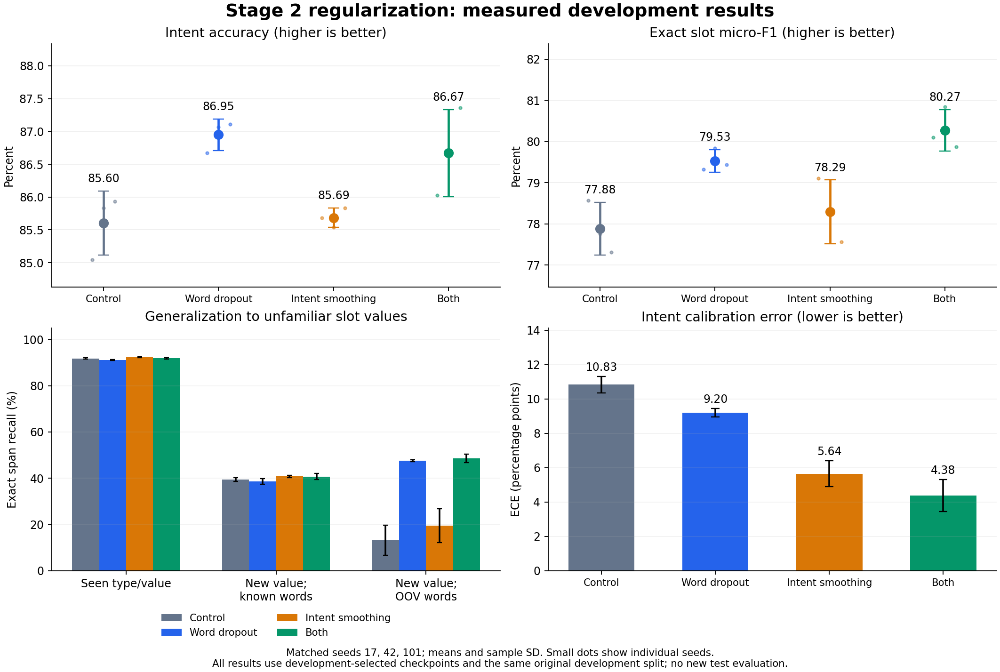

# Run the regularized Stage 2 Transformer

For the subsequent **60-epoch maximum with patience stopping**, use the
[early-stopping notebook and guide](TRANSFORMER_EARLY_STOPPING.md). This page
preserves the 20-epoch regularization experiment and its reproduction settings.

This revision implements the first two proposals from [the performance assessment](REVISED_TRANSFORMER_ASSESSMENT.md): frequency-dependent word-to-UNK dropout and mild intent label smoothing. Use **[NLP_Final_project_revised_regularized.ipynb](../NLP_Final_project_revised_regularized.ipynb)**. The earlier [revised notebook](../NLP_Final_project_revised.ipynb), original notebook, BiLSTM notebook and historical checkpoints are preserved.

The new notebook trains the original-size Stage 1 Transformer and then the revised Stage 2 Transformer. Both stages remain single joint models. Stage 2 still has **19,748,595 parameters**, including its word table, character encoder, shared Transformer, both heads and CRF. The additions are training procedures, not extra inference models or parameters.

Read [the measured comparison](TRANSFORMER_REGULARIZATION_RESULTS.md) and [machine-readable results](../results/transformer_regularization/results.json) for the actual experiment outcomes. The original-size Stage 1 model inside the notebook is not the control for isolating these additions: the experiment compares four versions of the same near-cap Stage 2 architecture.

The completed three-seed comparison gives **86.67% intent / 80.27% slot F1** with both additions, against **85.60% / 77.88%** for the control. Word dropout alone gives **86.95% / 79.53%**: it is the stronger intent-only result, while both additions give the highest equally weighted intent/F1 score. These are means of independently trained models, not an ensemble. The notebook's saved seed-42 run scores **86.62% / 80.84%**. No new test evaluation was performed.



## What changed

In the notebook's single editable configuration cell, the Stage 2 training dictionary includes:

```python
'word_dropout_alpha': 0.25,
'intent_label_smoothing': 0.05,
```

During training, each real ordinary-word position is independently replaced by UNK with probability `alpha / (original_training_frequency + alpha)`. Frequencies use only the original training split. Characters, masks, targets, token positions and source records remain unchanged. PAD and existing UNK IDs are excluded. The actual alpha .25 policy masks an expected 1.43% of training tokens, with realized counts recorded each epoch.

A dedicated seeded CPU generator supplies word-dropout draws. It does not consume the generator used for shuffled batches or the global stream used by model dropout. The generator continues across epochs and its state is saved with the checkpoint.

Label smoothing applies only to the training intent cross-entropy. The CRF objective is unchanged. Development/test inputs are never masked and their intent loss is ordinary, unsmoothed cross-entropy. Training intent-loss heights therefore should not be compared directly between smoothed and unsmoothed runs as if they were the same objective.

Set either option to `0.0` to disable it. Existing configurations without these fields also mean zero, preserving the historical training path. The standalone earlier notebook continues to use its own embedded historical implementation.

## Environment

Use the existing [requirements.txt](../requirements.txt) and **SC4002 (.venv)** Jupyter kernel, with Python 3.12 and the local CUDA GPU. No new dependency or downloaded embedding source is required. The [README setup instructions](../README.md#1-install-the-environment-once) apply.

Every run needs a **new directory**. Never reuse a directory containing `transformer_run_artifacts/`. Save configuration changes before starting a fresh kernel and running all cells.

The notebook snapshot retains the actual cache settings used for its recorded run. When moving the project or running on another machine, set `RUN_OPTIONS['dataset_path']` and `RUN_OPTIONS['embedding_archive']` to `None`, or replace them with valid local paths. With `None`, the notebook uses supplied environment cache paths or downloads the verified original data and permitted Word2Vec archive. It does not silently substitute random embeddings.

## Option A: run the notebook in Jupyter

From PowerShell in the repository root:

```powershell
$projectPath = (Get-Location).Path
$runPath = Join-Path $projectPath 'artifacts\regularized_notebook_runs\jupyter_001'
if (Test-Path -LiteralPath $runPath) { throw 'Choose a new run directory.' }
New-Item -ItemType Directory -Path $runPath | Out-Null
Copy-Item -LiteralPath (Join-Path $projectPath 'NLP_Final_project_revised_regularized.ipynb') -Destination $runPath
$env:PYTHONHASHSEED='42'
$env:CUBLAS_WORKSPACE_CONFIG=':4096:8'
Push-Location -LiteralPath $runPath
try {
    & (Join-Path $projectPath '.venv\Scripts\python.exe') -m jupyterlab
}
finally {
    Pop-Location
}
```

1. Open the copied **`NLP_Final_project_revised_regularized.ipynb`** and choose **SC4002 (.venv)**.
2. Edit the configuration cell if needed. Keep `evaluate_test=False` during experimentation.
3. Save, then **Restart Kernel and Run All Cells**. Keep the filename and kernel working directory together.
4. Wait for the completion output and save the notebook. Results are in this run directory's `transformer_run_artifacts/results.csv` and `results.json`; both genuine learning curves and development scores appear in the notebook.

The notebook embeds the implementation and evaluator. It does not import repository `src` modules or load a historical trained checkpoint to simulate a new run.

## Option B: execute the notebook from the terminal

This starts a Jupyter kernel without opening a browser and executes every cell:

```powershell
.\.venv\Scripts\python.exe scripts/execute_revised_transformer.py --notebook NLP_Final_project_revised_regularized.ipynb --execution-dir artifacts/regularized_notebook_runs/run_001 --dataset-cache data/1.0/data/en-US.jsonl --embedding-cache data/pretrained/nlpl_model_6.zip
```

The cache flags are optional; omit them if those files do not exist. If the notebook itself contains stale cache paths, reset those configuration values to `None` first. After successful execution, the executor saves the genuine outputs into the source notebook supplied with `--notebook` as well as the isolated run copy. The earlier revised notebook is untouched.

Independently audit a completed full notebook without another model forward pass:

```powershell
.\.venv\Scripts\python.exe scripts/validate_revised_transformer.py --notebook artifacts/regularized_notebook_runs/run_001/NLP_Final_project_revised_regularized.ipynb --run-root artifacts/regularized_notebook_runs/run_001/transformer_run_artifacts --output artifacts/regularized_notebook_runs/run_001_acceptance.json
```

Use a new acceptance filename. The validator checks dataset and source identity, complete epochs, development selection, parameter counts, saved predictions, fresh-process reload evidence, and the train-only regularization evidence.

## Run the controlled four-way Stage 2 experiment

The comparison runner fixes the four arms and 20-epoch budget:

| Arm | Word-dropout alpha | Intent smoothing |
| --- | ---: | ---: |
| `baseline` | 0 | 0 |
| `word_dropout` | .25 | 0 |
| `label_smoothing` | 0 | .05 |
| `combined` | .25 | .05 |

Run the seed-42 screen in a **new output root**:

```powershell
.\.venv\Scripts\python.exe scripts/run_transformer_regularization.py --output-root artifacts/transformer_regularization_repeat_001 --seeds 42 --execute-combined-notebook
```

The optional `--execute-combined-notebook` flag runs both notebook stages for the seed-42 combined arm, retaining genuine notebook outputs. The other arms execute Stage 2 only, using their notebook's embedded definitions in fresh Python processes. Without this flag all arms are Stage-2-only script runs. These script runs must not be described as complete two-stage notebook executions.

The protocol registers seeds **42, 17, 101**, all four settings, source hashes, the dataset/scorer, and the confirmation rule before training. If any changed seed-42 arm improves both required metrics over the fresh control, confirm all four arms with the other two seeds:

```powershell
.\.venv\Scripts\python.exe scripts/run_transformer_regularization.py --output-root artifacts/transformer_regularization_repeat_001 --seeds 17 101
```

Only previously unstarted arms can run under an existing protocol. Changed source code, changed assets, or an existing arm directory causes an error; register a new output root instead of mixing implementations or overwriting evidence. The runner prepares the same train-fitted embedding matrix for every arm of a seed and verifies equal initial model weights and training order. Active dropout arms must also have matching mask counts and private RNG states.

Each arm retains its registered notebook, full epoch history, best checkpoint, development predictions, regularization evidence and independent reload result. The selected epoch maximizes the earliest unrounded mean of intent accuracy and exact slot micro-F1. No test evaluation option is available in this experiment runner.

Measured times are descriptive. In the full-notebook option, combined Stage 2 follows Stage 1 in the same CUDA process; the other arms start independent processes. This is a controlled predictive-performance comparison, not a strict runtime benchmark.

## Results and the existing test reference

Use the comparison analysis tools to regenerate tables and uncertainty estimates from completed artifacts; see the commands and evidence paths in [the result report](TRANSFORMER_REGULARIZATION_RESULTS.md). The comparison includes both required metrics, slot precision/recall, joint correctness, unfamiliar-value/OOV breakdowns, and paired comparisons. Several seeds distinguish repeatable effects from one favorable training run.

For the default registered study directory:

```powershell
.\.venv\Scripts\python.exe scripts/analyze_transformer_regularization.py
.\.venv\Scripts\python.exe scripts/analyze_transformer_regularization_confidence.py --device cuda
.\.venv\Scripts\python.exe scripts/analyze_transformer_regularization.py --confidence results/transformer_regularization/confidence.json
.\.venv\Scripts\python.exe scripts/plot_transformer_regularization.py
```

The first command independently rescores saved development predictions without model inference. The second performs read-only development inference from selected frozen checkpoints, checks every saved prediction, and measures confidence/calibration; it refuses to overwrite an existing confidence report, so use a fresh `--output` filename when repeating it. The third command explicitly incorporates that report after checking its cohort, checkpoints, predictions and source hashes. The plot command uses the two completed JSON reports and performs no model inference. For another study directory, pass `--run-root` to the analyzers and use new output paths; pass those result paths to the plotting command. Do not run the GPU confidence audit concurrently with training when collecting its own evaluation evidence.

The previous revised model's test result is a separate, already-exposed frozen reference. This regularization study uses development only. Do not substitute its development gains for measured test gains or describe a future reuse of that test as a newly untouched evaluation.
